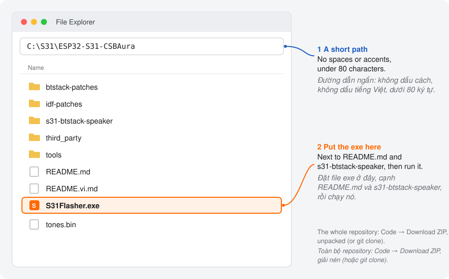
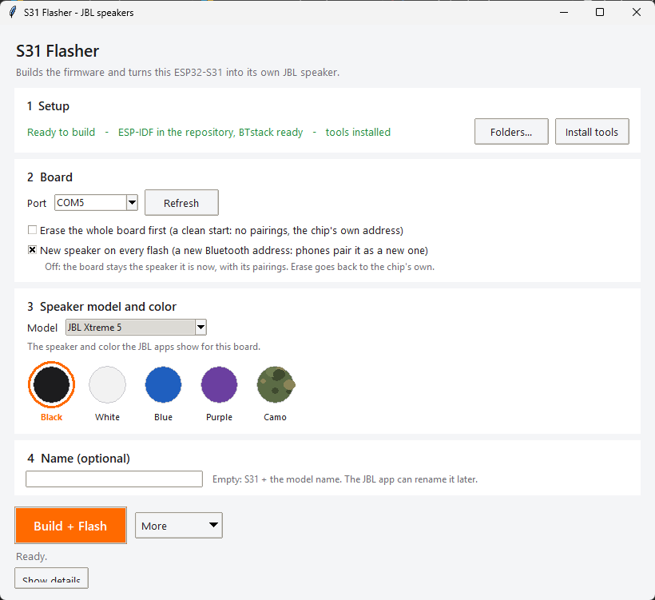

# ESP32-S31 CSBAura

**English** | [Tiếng Việt](README.vi.md)

This firmware turns an **ESP32-S31** board into a speaker that behaves like a **JBL Xtreme 5**:

- Phones play to it over Classic Bluetooth (A2DP, SBC or AAC) or LE Audio. Two phones can be
  connected at once.
- It makes a **stereo pair** with a real Xtreme 5 (JBL One → **Create a Stereo Pair**), as
  the left or the right speaker.
- Real Xtreme 5 speakers join its Auracast party with their own Auracast button, and it can
  join another JBL party.
- The JBL One app sees it as an Xtreme 5 (or another JBL model you pick) in the color you
  pick, with its settings, EQ, light themes and party pages.

## Contents

- [Quick start (Windows, S31 Flasher)](#quick-start-windows-s31-flasher)
- [A new speaker on every flash, or the same one](#a-new-speaker-on-every-flash-or-the-same-one)
- [Using the speaker](#using-the-speaker)
- [Features](#features)
- [Hardware](#hardware)
- [What's in this repository](#whats-in-this-repository)
- [Build from source (any OS)](#build-from-source-any-os)
- [Prompt tones](#prompt-tones)
- [Troubleshooting](#troubleshooting)
- [Licenses](#licenses)

## Quick start (Windows, S31 Flasher)



### Easiest: the complete download (everything, works offline)

On the [Releases](../../releases) page, download **`S31-CSBAura-complete-win64.zip`** (about
1.3 GB). It holds everything this project is built and tested with:
- this repository with the patched ESP-IDF and BTstack,
- `S31Flasher.exe`,
- ESP-IDF's tools for the ESP32-S31: compiler, debugger, CMake, Ninja and the rest,
- the Python packages for ESP-IDF's Python environment,
- the Python 3.12 installer.

Unzip it to `C:\S31`, so you get `C:\S31\ESP32-S31-CSBAura`. Run `S31Flasher.exe` in that
folder and press **Build + Flash** (steps 6 to 10 below). The first build installs the tools
from the `S31-offline` folder, with no internet at all.

### Or: the repository and the flasher separately

1. **Get the repository.** On GitHub use **Code → Download ZIP** and unpack it, or
   `git clone` it. It already contains the patched ESP-IDF and BTstack: nothing has to be
   cloned or patched.
2. **Put it at a short path**, for example `C:\S31\ESP32-S31-CSBAura`: under 80 characters,
   no spaces, no accented letters. ESP-IDF's deepest files sit 175 characters deep inside it,
   and Windows paths stop at 260.
3. **Get the flasher.** Download `S31Flasher.exe` from the [Releases](../../releases) page
   and put it **in that folder, next to `README.md` and `s31-btstack-speaker`** (picture
   above).
4. **Run `S31Flasher.exe`.** If SmartScreen warns about an unknown app, choose
   **More info → Run anyway**.

   

5. **1 Setup** says **Ready to build**. Nothing else to install: the first **Build + Flash**
   installs ESP-IDF's compiler and tools by itself (about 1 GB into
   `%USERPROFILE%\.espressif`, several minutes, once). If the PC has no Python 3.10 to 3.13,
   it first installs Python 3.12 from python.org, for this user only.
6. **2 Board**: plug in the board and pick its port (**Refresh** after plugging it in).
   Leave **New speaker on every flash** on or turn it off (see the next section).
7. **3 Speaker model and color**: the model (JBL Xtreme 5 by default) and a color.
8. **4 Name** (optional): the Bluetooth name. Empty means `S31 JBL Xtreme 5`.
9. **Press Build + Flash.** The first build takes a few minutes, later ones about a minute.
   The board restarts by itself.
10. **Pair it** from the phone's Bluetooth settings. A board with no phone paired starts in
    pairing mode by itself.

**More → Set model / color / name only** changes just those in a few seconds and keeps the
firmware, the identity, the pairings and the settings.

Xtreme 5 colors (JBL's own IDs, as JBL One reads them from the speaker's beacon):

| Color | ID |
|---|---|
| Black | `0x00` |
| White | `0x01` |
| Blue | `0x02` |
| Purple | `0x05` |
| Camo | `0x1A` |

Everything about the flasher, including its command line:
[`tools/flasher/README.md`](tools/flasher/README.md).

## A new speaker on every flash, or the same one

The speaker's identity is its Bluetooth address. Its serial number, beacon address,
`macCrc` (how JBL One and JBL speakers tell speakers apart) and Auracast Broadcast_ID all
follow from that address.

| Flasher setting | The board after flashing |
|---|---|
| **New speaker on every flash** on (default) | A brand-new Xtreme 5: a new Bluetooth address and everything that follows from it. Phones and JBL One see a new speaker and pair with it as with one out of the box; it starts in pairing mode. |
| Off | The same speaker it was: its address, pairings, stereo pair and settings stay. |
| **Erase the whole board first** | A clean start on the chip's own factory address (unique per chip). |

When the address changes, the board clears the pairings made with the old one. A phone keeps
its entry for the old speaker; you can forget that one on the phone.

## Using the speaker

| Do this | And |
|---|---|
| **Pair a phone** | Press the pairing button. The speaker is discoverable for 3 minutes. Like the Xtreme 5, pairing mode drops the phones that were connected; when it ends they come back by themselves, and after a new phone paired, the one before it comes back as the second phone. |
| **Two phones** | Both stay connected. The one that starts playing takes over; the other one is paused. |
| **Power on** | The power-on sound plays, the speaker calls back the phone it played last and then the one before it. The "connected" sound waits for the power-on sound. |
| **Stereo pair** | In JBL One open the Xtreme 5 (or the S31) → **Create a Stereo Pair**, pick the other one, answer which side the sound came from. Each speaker then plays one channel. The pair comes back by itself after power-off. |
| **Auracast party** | Press the Auracast button (or use JBL One). Real Xtreme 5 speakers join when you press their Auracast button. |
| **JBL One** | Settings, EQ, light themes, rename, feedback tone, auto power off, product information. |

**In a stereo pair:**
- The S31 can be either speaker. As the second speaker it plays the first speaker's
  broadcast and has no phone of its own; its buttons work the first speaker (volume,
  play/pause, pairing).
- EQ, light theme, volume and the feedback-tone setting follow the first speaker.
- It is not Auracast: the Auracast light and setting stay off, as on two real Xtreme 5s.

**Auto power off** is **Never** by default: the speaker stays on. Turn it on in JBL One →
Product Settings → Auto Power Off if you want it.

## Features

| Feature | What it does | Source |
|---|---|---|
| A2DP sink | SBC or AAC-LC, resampled to 48 kHz with clock recovery; AVRCP absolute volume, play/pause, track info | `a2dp_in.c` |
| Two phones | Two A2DP endpoint pairs; the one that plays wins, the other is paused | `a2dp_in.c` |
| Reconnect | Calls back the last phone and the one before it at power-up and after pairing mode | `a2dp_in.c` |
| LE Audio sink | BAP unicast (LC3) with volume control | `le_audio.c` |
| Stereo pair | JBL's private stereo link with a real Xtreme 5 (LE link + broadcast + PAST), both roles | `lls.c`, `party.c`, `jbl_v5.c` |
| Auracast (JBL party host) | The advertising and BIG layout of a real Xtreme 5 party master | `auracast.c`, `jbl_beacon.c` |
| Party listen | Plays another JBL party master's broadcast in sync | `party.c` |
| JBL One app | JBL's V5 protocol over GATT (Classic and LE): settings, EQ, lights, rename, party, Auracast Assistant | `jbl_v5.c`, `jbl_gatt.c` |
| Identity and model | Address, serial, beacon and Broadcast_ID; model, color and name from the `s31cfg` partition | `s31_ident.c` |
| Local output | 48 kHz 32-bit stereo I2S to a DAC or amplifier | `audio_out.c` |
| Prompt tones | From the `tones` partition | `tones.c` |

More on the modules: [`s31-btstack-speaker/README.md`](s31-btstack-speaker/README.md).

## Hardware

- ESP32-S31 board with 16 MB flash and PSRAM.
- An I2S DAC or amplifier (optional; Auracast and the stereo link work without it).
- Five push buttons to GND (optional; internal pull-ups, active low).

| Signal | GPIO |
|---|---|
| I2S BCK / DOUT / LRCK | 35 / 37 / 39 |
| Button: Auracast on/off | 36 |
| Button: volume up / down | 38 / 40 |
| Button: Bluetooth pairing | 42 |
| Button: play / pause | 44 |

## What's in this repository

| Path | What |
|---|---|
| `s31-btstack-speaker/` | The firmware (ESP-IDF project) |
| `third_party/esp-idf/` | ESP-IDF by Espressif, already patched, see [`S31_README.md`](third_party/esp-idf/S31_README.md) |
| `third_party/btstack/` | BTstack by BlueKitchen, already patched (only the parts the firmware uses), see [`S31_README.md`](third_party/btstack/S31_README.md) |
| `btstack-patches/` | Our BTstack patches and the BTstack commit they apply to |
| `idf-patches/` | Our ESP-IDF patches and the ESP-IDF commit they apply to |
| `tools/flasher/` | The S31 Flasher (source of `S31Flasher.exe`) |
| `tools/release/` | How `third_party` is made from the upstream repositories |
| `tools/tones_pack.py` | Packs your own prompt tone files into `tones.bin` |
| `docs/` | The pictures in this README |

## Build from source (any OS)

The flasher only automates these steps.

### 1. ESP-IDF

ESP-IDF **v6.1** with ESP32-S31 support, exactly commit `c43d665a96` of `release/v6.1`
(`idf-patches/IDF_COMMIT`), with `idf-patches/0010-controller-only-iso-rx.patch` and
`idf-patches/0011-btdm-task-stack-dma.patch` applied. Both are required: without 0010 a
controller-only build drops every received ISO packet; without 0011 the controller's AES
gives wrong results, so LE pairing, LE Audio and Classic Secure Connections fail. See
[`idf-patches/README.md`](idf-patches/README.md).

**Easiest:** use the one in this repository; only its tools need installing, once:

```bash
cd third_party/esp-idf
./install.sh esp32s31 && . ./export.sh      # Windows: .\install.ps1 esp32s31; . .\export.ps1
```

**Or with git**, somewhere else:

```bash
git clone --no-checkout https://github.com/espressif/esp-idf esp-idf-s31
cd esp-idf-s31
git checkout $(cat <repo>/idf-patches/IDF_COMMIT)
git submodule update --init --recursive --depth 1
git apply <repo>/idf-patches/0010-controller-only-iso-rx.patch
git apply <repo>/idf-patches/0011-btdm-task-stack-dma.patch
./install.sh esp32s31 && . ./export.sh
```

### 2. BTstack

Nothing to do: `third_party/btstack` is already patched. To make it again from BlueKitchen's
repository, see [`third_party/btstack/S31_README.md`](third_party/btstack/S31_README.md).

### 3. Build and flash

```bash
cd s31-btstack-speaker
idf.py build
idf.py -p <PORT> flash monitor        # console at 921600 baud
```

`idf.py flash` doesn't write the `s31cfg` partition (model, color, name, identity). A board
that never had one is a Black Xtreme 5 on its chip address. To set them, use the flasher's
command line:

```bash
python tools/flasher/s31_flasher.py --port <PORT> --color blue --color-only
```

### Flash layout

| Name | Offset | Size | Use |
|---|---|---|---|
| `nvs` | 0x9000 | 24 KB | Pairings, settings |
| `phy_init` | 0xF000 | 4 KB | PHY calibration |
| `factory` | 0x10000 | 4 MB | Application |
| `jblota` | 0x410000 | 4 MB | Captured JBL One OTA image (not executed) |
| `tones` | 0x810000 | 2 MB | Prompt tones |
| `s31cfg` | 0xA10000 | 4 KB | Model, color, name and identity (written by the flasher) |

## Prompt tones

`tones.bin` in the repository root holds the Xtreme 5 prompt set, and the S31 Flasher writes
it with the firmware. The tones are JBL's audio, so this repository has to stay **private**
while it holds them.

### Your own sounds

1. Make a folder with sound files **named after the prompt they replace**. WAV, MP3, FLAC,
   OGG, M4A/AAC or raw `.pcm`, any sample rate, mono or stereo; they're converted to 24 kHz
   mono.

   | File name | Plays when |
   |---|---|
   | `poweron` | the speaker starts |
   | `poweroff` | the speaker powers off |
   | `bt_pair` | pairing mode starts (button, or LE Audio switched in JBL One) |
   | `bt_cnt` | a phone has connected |
   | `ent_aura` / `exi_aura` | Auracast is turned on / off |
   | `vol_max` | the volume hits its maximum or minimum |
   | `indicate` | JBL One identifies the speaker, or a stereo pair is set up |
   | `c_err` | JBL One's firmware update is refused |
   | `batlow`, `mic_con`, `usound`, `0` ... `9` | packed, not played by the firmware yet |

2. Pack them. This needs [ffmpeg](https://ffmpeg.org) on the PATH:

   ```bash
   # replace only the tones in the folder, keep all the others:
   python tools/tones_pack.py my_tones tones.bin --base tones.bin

   # or a completely new set (prompts without a file stay silent):
   python tools/tones_pack.py my_tones tones.bin
   ```

   The whole set must fit in 2 MB, about 43 s of sound.

3. **Build + Flash** (or **More → Flash the last build**) with the S31 Flasher.

Keep prompts short (under 1–2 s, except `bt_pair`). The music is lowered while a tone plays.

## Troubleshooting

| Problem | Fix |
|---|---|
| The board doesn't show up as a port | Use a USB data cable; hold BOOT, press RESET, release BOOT. |
| Flashing says the port is busy | Close any serial monitor using the port. |
| The phone can't connect | Press the pairing button and pick the speaker on the phone. After a new-speaker flash or an Erase, forget the old entry on the phone. |
| JBL One shows the speaker as Unavailable | Bluetooth must be on and the phone connected to it (JBL One controls an Xtreme 5 over that connection). |
| Xtreme 5 speakers don't join the party | Press their Auracast button while the board hosts; keep them within a few meters. |
| No sound from the I2S output | Check the DAC wiring (GPIO 35/37/39). |

More: [`tools/flasher/README.md`](tools/flasher/README.md#troubleshooting).

## Licenses

- **BTstack** (`third_party/btstack`) is © BlueKitchen GmbH under its own
  [license](third_party/btstack/LICENSE). Redistribution and use are allowed **for personal,
  non-commercial purposes only**. For anything else, get a commercial license from
  BlueKitchen. This project, built with it, carries the same restriction.
- **ESP-IDF** (`third_party/esp-idf`) is © Espressif Systems under Apache-2.0; some of its
  components carry their own licenses in their folders.
- JBL, Xtreme and Auracast are trademarks of their owners. This is an independent hobby
  project, not affiliated with or endorsed by Harman or JBL.
