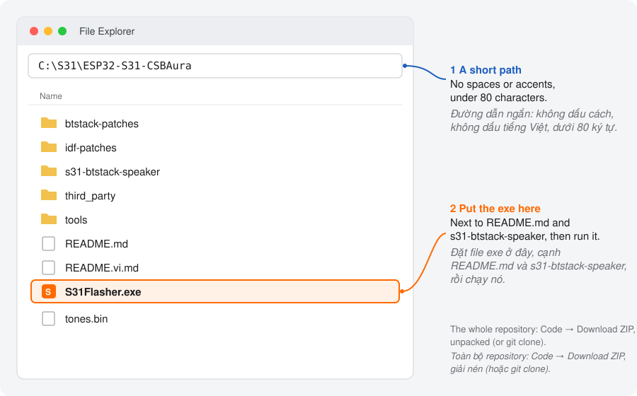
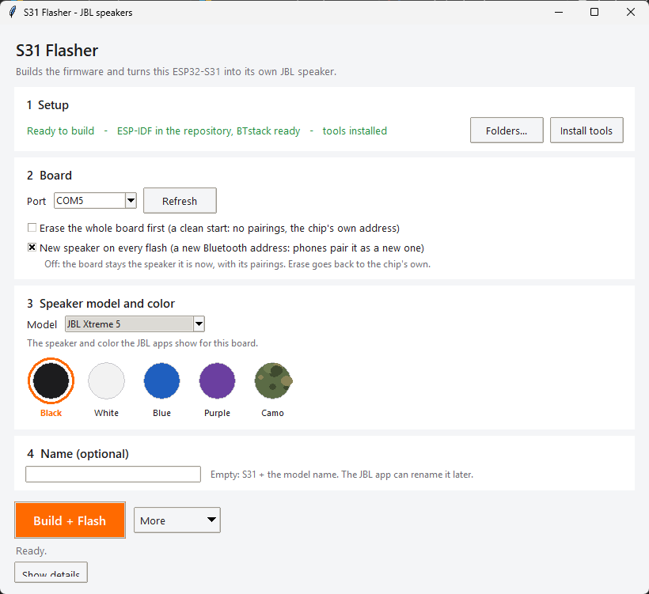

# ESP32-S31 CSBAura

[English](README.md) | **Tiếng Việt**

Firmware này biến một bo mạch **ESP32-S31** thành một chiếc loa hoạt động như **JBL Xtreme 5**:

- Điện thoại phát nhạc tới loa qua Bluetooth Classic (A2DP, SBC hoặc AAC) hoặc LE Audio. Có
  thể kết nối hai điện thoại cùng lúc.
- Loa ghép **cặp stereo** với một chiếc Xtreme 5 thật (JBL One → **Create a Stereo Pair**),
  làm loa trái hoặc loa phải.
- Loa Xtreme 5 thật tham gia bữa tiệc Auracast của nó bằng chính nút Auracast của chúng, và nó
  cũng có thể tham gia bữa tiệc của một loa JBL khác.
- Ứng dụng JBL One nhận nó là một chiếc Xtreme 5 (hoặc một mẫu JBL khác bạn chọn) với màu bạn
  chọn, có đủ cài đặt, EQ, hiệu ứng đèn và các trang bữa tiệc.

## Mục lục

- [Bắt đầu nhanh (Windows, S31 Flasher)](#bắt-đầu-nhanh-windows-s31-flasher)
- [Mỗi lần nạp là một loa mới, hay giữ nguyên loa cũ](#mỗi-lần-nạp-là-một-loa-mới-hay-giữ-nguyên-loa-cũ)
- [Sử dụng loa](#sử-dụng-loa)
- [Tính năng](#tính-năng)
- [Phần cứng](#phần-cứng)
- [Trong repository có gì](#trong-repository-có-gì)
- [Tự build từ mã nguồn (mọi hệ điều hành)](#tự-build-từ-mã-nguồn-mọi-hệ-điều-hành)
- [Âm báo](#âm-báo)
- [Xử lý sự cố](#xử-lý-sự-cố)
- [Giấy phép](#giấy-phép)

## Bắt đầu nhanh (Windows, S31 Flasher)



### Dễ nhất: bản tải đầy đủ (có tất cả, chạy không cần mạng)

Trên trang [Releases](../../releases), tải **`S31-CSBAura-complete-win64.zip`** (khoảng 1,3 GB).
Trong đó có mọi thứ dự án này dùng để build và kiểm thử:
- repository này cùng ESP-IDF và BTstack đã vá,
- `S31Flasher.exe`,
- công cụ ESP-IDF cho ESP32-S31: trình biên dịch, trình gỡ lỗi, CMake, Ninja và các công cụ khác,
- các gói Python cho môi trường Python của ESP-IDF,
- bộ cài Python 3.12.

Giải nén vào `C:\S31` để có `C:\S31\ESP32-S31-CSBAura`. Chạy `S31Flasher.exe` trong thư mục đó
và bấm **Build + Flash** (các bước 6 đến 10 bên dưới). Lần build đầu cài công cụ từ thư mục
`S31-offline`, hoàn toàn không cần internet.

### Hoặc: tải repository và trình nạp riêng

1. **Tải repository.** Trên GitHub chọn **Code → Download ZIP** rồi giải nén, hoặc dùng
   `git clone`. Trong đó đã có sẵn ESP-IDF và BTstack đã vá: không cần clone hay vá gì thêm.
2. **Đặt nó ở một đường dẫn ngắn**, ví dụ `C:\S31\ESP32-S31-CSBAura`: dưới 80 ký tự, không có
   dấu cách, không có chữ có dấu. Các file sâu nhất của ESP-IDF nằm sâu 175 ký tự bên trong, và
   đường dẫn trên Windows bị giới hạn ở 260 ký tự.
3. **Tải trình nạp.** Tải `S31Flasher.exe` từ trang [Releases](../../releases) và đặt nó
   **vào đúng thư mục đó, cạnh `README.md` và `s31-btstack-speaker`** (xem hình trên).
4. **Chạy `S31Flasher.exe`.** Nếu SmartScreen cảnh báo ứng dụng không rõ nguồn gốc, chọn
   **More info → Run anyway**.

   

5. **1 Setup** hiện **Ready to build**. Không cần cài thêm gì: lần **Build + Flash** đầu tiên
   tự cài trình biên dịch và công cụ của ESP-IDF (khoảng 1 GB vào `%USERPROFILE%\.espressif`,
   mất vài phút, chỉ một lần). Nếu máy chưa có Python 3.10 đến 3.13, nó sẽ cài Python 3.12 từ
   python.org trước, chỉ cho người dùng hiện tại.
6. **2 Board**: cắm bo mạch và chọn cổng của nó (bấm **Refresh** sau khi cắm). Bật hoặc tắt
   **New speaker on every flash** (xem phần sau).
7. **3 Speaker model and color**: chọn mẫu loa (mặc định JBL Xtreme 5) và màu.
8. **4 Name** (không bắt buộc): tên Bluetooth. Để trống thì tên là `S31 JBL Xtreme 5`.
9. **Bấm Build + Flash.** Lần build đầu mất vài phút, các lần sau khoảng một phút. Bo mạch tự
   khởi động lại.
10. **Ghép đôi** từ phần Bluetooth của điện thoại. Bo mạch chưa ghép với điện thoại nào sẽ tự
    vào chế độ ghép đôi.

**More → Set model / color / name only** chỉ đổi mẫu, màu và tên trong vài giây, giữ nguyên
firmware, danh tính, các thiết bị đã ghép và cài đặt.

Màu của Xtreme 5 (mã riêng của JBL, JBL One đọc từ beacon của loa):

| Màu | Mã |
|---|---|
| Black (Đen) | `0x00` |
| White (Trắng) | `0x01` |
| Blue (Xanh dương) | `0x02` |
| Purple (Tím) | `0x05` |
| Camo (Rằn ri) | `0x1A` |

Mọi thứ về trình nạp, kể cả dòng lệnh: [`tools/flasher/README.vi.md`](tools/flasher/README.vi.md).

## Mỗi lần nạp là một loa mới, hay giữ nguyên loa cũ

Danh tính của loa là địa chỉ Bluetooth của nó. Số serial, địa chỉ beacon, `macCrc` (cách JBL
One và các loa JBL phân biệt từng loa) và Auracast Broadcast_ID đều suy ra từ địa chỉ đó.

| Cài đặt trong trình nạp | Bo mạch sau khi nạp |
|---|---|
| **New speaker on every flash** bật (mặc định) | Một chiếc Xtreme 5 hoàn toàn mới: địa chỉ Bluetooth mới và mọi thứ suy ra từ nó. Điện thoại và JBL One thấy một loa mới và ghép đôi như với loa mới mua; loa tự vào chế độ ghép đôi. |
| Tắt | Vẫn là chiếc loa cũ: giữ địa chỉ, các thiết bị đã ghép, cặp stereo và cài đặt. |
| **Erase the whole board first** | Bắt đầu sạch với địa chỉ gốc của chip (mỗi chip một địa chỉ riêng). |

Khi địa chỉ đổi, bo mạch xóa các ghép đôi đã làm với địa chỉ cũ. Điện thoại vẫn giữ mục của
loa cũ; bạn có thể xóa (forget) mục đó trên điện thoại.

## Sử dụng loa

| Làm thế này | Và |
|---|---|
| **Ghép đôi điện thoại** | Bấm nút ghép đôi. Loa hiện ra để ghép trong 3 phút. Giống Xtreme 5, chế độ ghép đôi ngắt các điện thoại đang kết nối; khi chế độ này kết thúc chúng tự kết nối lại, và sau khi ghép một điện thoại mới, điện thoại trước đó quay lại làm điện thoại thứ hai. |
| **Hai điện thoại** | Cả hai cùng kết nối. Điện thoại nào bắt đầu phát sẽ được phát; điện thoại kia bị tạm dừng. |
| **Bật loa** | Âm khởi động phát, loa gọi lại điện thoại phát gần nhất rồi đến điện thoại trước đó. Âm "đã kết nối" chờ âm khởi động phát xong. |
| **Cặp stereo** | Trong JBL One mở chiếc Xtreme 5 (hoặc S31) → **Create a Stereo Pair**, chọn chiếc còn lại, trả lời âm thanh phát ra từ bên nào. Sau đó mỗi loa phát một kênh. Cặp tự kết nối lại sau khi tắt bật. |
| **Bữa tiệc Auracast** | Bấm nút Auracast (hoặc dùng JBL One). Loa Xtreme 5 thật tham gia khi bạn bấm nút Auracast của chúng. |
| **JBL One** | Cài đặt, EQ, hiệu ứng đèn, đổi tên, âm phản hồi, tự tắt nguồn, thông tin sản phẩm. |

**Trong cặp stereo:**
- S31 làm được cả hai vai. Khi là loa thứ hai, nó phát luồng của loa thứ nhất và không có điện
  thoại riêng; các nút của nó điều khiển loa thứ nhất (âm lượng, phát/tạm dừng, ghép đôi).
- EQ, hiệu ứng đèn, âm lượng và cài đặt âm phản hồi theo loa thứ nhất.
- Đây không phải Auracast: đèn và cài đặt Auracast vẫn tắt, giống như hai chiếc Xtreme 5 thật.

**Tự tắt nguồn** mặc định là **Never** (Không bao giờ): loa luôn bật. Muốn bật lại thì vào
JBL One → Product Settings → Auto Power Off.

## Tính năng

| Tính năng | Làm gì | Mã nguồn |
|---|---|---|
| A2DP sink | SBC hoặc AAC-LC, chuyển về 48 kHz có khôi phục xung nhịp; âm lượng tuyệt đối AVRCP, phát/tạm dừng, thông tin bài hát | `a2dp_in.c` |
| Hai điện thoại | Hai cặp endpoint A2DP; điện thoại đang phát được ưu tiên, điện thoại kia tạm dừng | `a2dp_in.c` |
| Tự kết nối lại | Gọi lại điện thoại gần nhất và điện thoại trước đó khi bật loa và sau chế độ ghép đôi | `a2dp_in.c` |
| LE Audio sink | BAP unicast (LC3) có điều khiển âm lượng | `le_audio.c` |
| Cặp stereo | Liên kết stereo riêng của JBL với Xtreme 5 thật (liên kết LE + broadcast + PAST), cả hai vai | `lls.c`, `party.c`, `jbl_v5.c` |
| Auracast (chủ bữa tiệc JBL) | Quảng bá và cấu trúc BIG giống một Xtreme 5 thật làm chủ bữa tiệc | `auracast.c`, `jbl_beacon.c` |
| Nghe bữa tiệc | Phát luồng của một loa JBL chủ bữa tiệc khác, đồng bộ | `party.c` |
| Ứng dụng JBL One | Giao thức V5 của JBL qua GATT (Classic và LE): cài đặt, EQ, đèn, đổi tên, bữa tiệc, Auracast Assistant | `jbl_v5.c`, `jbl_gatt.c` |
| Danh tính và mẫu loa | Địa chỉ, serial, beacon và Broadcast_ID; mẫu, màu và tên từ phân vùng `s31cfg` | `s31_ident.c` |
| Ngõ ra tại chỗ | I2S 48 kHz 32-bit stereo tới DAC hoặc ampli | `audio_out.c` |
| Âm báo | Từ phân vùng `tones` | `tones.c` |

Thêm về các module: [`s31-btstack-speaker/README.md`](s31-btstack-speaker/README.md) (tiếng Anh).

## Phần cứng

- Bo mạch ESP32-S31 có 16 MB flash và PSRAM.
- Một DAC hoặc ampli I2S (không bắt buộc; Auracast và liên kết stereo vẫn chạy khi không có).
- Năm nút bấm nối xuống GND (không bắt buộc; có điện trở kéo lên bên trong, tích cực mức thấp).

| Tín hiệu | GPIO |
|---|---|
| I2S BCK / DOUT / LRCK | 35 / 37 / 39 |
| Nút: bật/tắt Auracast | 36 |
| Nút: tăng / giảm âm lượng | 38 / 40 |
| Nút: ghép đôi Bluetooth | 42 |
| Nút: phát / tạm dừng | 44 |

## Trong repository có gì

| Đường dẫn | Là gì |
|---|---|
| `s31-btstack-speaker/` | Firmware (dự án ESP-IDF) |
| `third_party/esp-idf/` | ESP-IDF của Espressif, đã vá sẵn, xem [`S31_README.md`](third_party/esp-idf/S31_README.md) |
| `third_party/btstack/` | BTstack của BlueKitchen, đã vá sẵn (chỉ phần firmware dùng), xem [`S31_README.md`](third_party/btstack/S31_README.md) |
| `btstack-patches/` | Các bản vá BTstack của chúng tôi và commit BTstack chúng áp vào |
| `idf-patches/` | Các bản vá ESP-IDF của chúng tôi và commit ESP-IDF chúng áp vào |
| `tools/flasher/` | S31 Flasher (mã nguồn của `S31Flasher.exe`) |
| `tools/release/` | Cách tạo `third_party` từ các repository gốc |
| `tools/tones_pack.py` | Đóng gói các file âm báo của bạn thành `tones.bin` |
| `docs/` | Các hình trong README này |

## Tự build từ mã nguồn (mọi hệ điều hành)

Trình nạp chỉ tự động hóa các bước này.

### 1. ESP-IDF

ESP-IDF **v6.1** có hỗ trợ ESP32-S31, đúng commit `c43d665a96` của nhánh `release/v6.1`
(`idf-patches/IDF_COMMIT`), đã áp `idf-patches/0010-controller-only-iso-rx.patch` và
`idf-patches/0011-btdm-task-stack-dma.patch`. Cả hai đều bắt buộc: thiếu 0010 thì bản build
chỉ-controller bỏ mọi gói ISO nhận được; thiếu 0011 thì bộ AES của controller cho kết quả sai,
nên ghép đôi LE, LE Audio và Secure Connections trên Classic đều hỏng. Xem
[`idf-patches/README.md`](idf-patches/README.md).

**Dễ nhất:** dùng bản có sẵn trong repository; chỉ cần cài công cụ của nó, một lần:

```bash
cd third_party/esp-idf
./install.sh esp32s31 && . ./export.sh      # Windows: .\install.ps1 esp32s31; . .\export.ps1
```

**Hoặc dùng git**, ở chỗ khác:

```bash
git clone --no-checkout https://github.com/espressif/esp-idf esp-idf-s31
cd esp-idf-s31
git checkout $(cat <repo>/idf-patches/IDF_COMMIT)
git submodule update --init --recursive --depth 1
git apply <repo>/idf-patches/0010-controller-only-iso-rx.patch
git apply <repo>/idf-patches/0011-btdm-task-stack-dma.patch
./install.sh esp32s31 && . ./export.sh
```

### 2. BTstack

Không cần làm gì: `third_party/btstack` đã được vá sẵn. Muốn tạo lại từ repository của
BlueKitchen, xem [`third_party/btstack/S31_README.md`](third_party/btstack/S31_README.md).

### 3. Build và nạp

```bash
cd s31-btstack-speaker
idf.py build
idf.py -p <CỔNG> flash monitor        # console ở 921600 baud
```

`idf.py flash` không ghi phân vùng `s31cfg` (mẫu, màu, tên, danh tính). Bo mạch chưa từng có
phân vùng này sẽ là một chiếc Xtreme 5 màu Đen dùng địa chỉ của chip. Muốn đặt các giá trị đó,
dùng dòng lệnh của trình nạp:

```bash
python tools/flasher/s31_flasher.py --port <CỔNG> --color blue --color-only
```

### Bố cục bộ nhớ flash

| Tên | Vị trí | Dung lượng | Dùng cho |
|---|---|---|---|
| `nvs` | 0x9000 | 24 KB | Ghép đôi, cài đặt |
| `phy_init` | 0xF000 | 4 KB | Hiệu chuẩn PHY |
| `factory` | 0x10000 | 4 MB | Ứng dụng |
| `jblota` | 0x410000 | 4 MB | Ảnh OTA của JBL One đã thu (không chạy) |
| `tones` | 0x810000 | 2 MB | Âm báo |
| `s31cfg` | 0xA10000 | 4 KB | Mẫu, màu, tên và danh tính (do trình nạp ghi) |

## Âm báo

`tones.bin` ở thư mục gốc chứa bộ âm báo của Xtreme 5, và S31 Flasher ghi nó cùng với firmware.
Đây là âm thanh của JBL, nên repository này phải để **riêng tư (private)** khi còn chứa chúng.

### Âm thanh của riêng bạn

1. Tạo một thư mục chứa các file âm thanh **đặt tên theo âm báo mà nó thay thế**. WAV, MP3,
   FLAC, OGG, M4A/AAC hoặc `.pcm` thô, tần số lấy mẫu bất kỳ, mono hay stereo đều được; chúng
   được chuyển về 24 kHz mono.

   | Tên file | Phát khi |
   |---|---|
   | `poweron` | loa khởi động |
   | `poweroff` | loa tắt |
   | `bt_pair` | bắt đầu chế độ ghép đôi (nút bấm, hoặc bật LE Audio trong JBL One) |
   | `bt_cnt` | một điện thoại đã kết nối |
   | `ent_aura` / `exi_aura` | bật / tắt Auracast |
   | `vol_max` | âm lượng chạm mức lớn nhất hoặc nhỏ nhất |
   | `indicate` | JBL One nhận diện loa, hoặc khi thiết lập cặp stereo |
   | `c_err` | bản cập nhật firmware của JBL One bị từ chối |
   | `batlow`, `mic_con`, `usound`, `0` ... `9` | được đóng gói nhưng firmware chưa phát |

2. Đóng gói chúng. Cần [ffmpeg](https://ffmpeg.org) trong PATH:

   ```bash
   # chỉ thay các âm có trong thư mục, giữ nguyên các âm còn lại:
   python tools/tones_pack.py my_tones tones.bin --base tones.bin

   # hoặc một bộ hoàn toàn mới (âm nào không có file sẽ im lặng):
   python tools/tones_pack.py my_tones tones.bin
   ```

   Cả bộ phải vừa 2 MB, khoảng 43 giây âm thanh.

3. **Build + Flash** (hoặc **More → Flash the last build**) bằng S31 Flasher.

Nên để âm báo ngắn (dưới 1–2 giây, trừ `bt_pair`). Nhạc được giảm nhỏ khi âm báo phát.

## Xử lý sự cố

| Vấn đề | Cách khắc phục |
|---|---|
| Bo mạch không hiện ra cổng | Dùng cáp USB có truyền dữ liệu; giữ BOOT, bấm RESET, thả BOOT. |
| Nạp báo cổng đang bận | Đóng mọi chương trình serial monitor đang dùng cổng đó. |
| Điện thoại không kết nối được | Bấm nút ghép đôi và chọn loa trên điện thoại. Sau khi nạp loa mới hoặc Erase, xóa mục cũ trên điện thoại. |
| JBL One hiện loa là Unavailable | Bluetooth phải bật và điện thoại phải đang kết nối với loa (JBL One điều khiển Xtreme 5 qua kết nối đó). |
| Loa Xtreme 5 không tham gia bữa tiệc | Bấm nút Auracast của chúng khi bo mạch đang làm chủ; để chúng trong vòng vài mét. |
| Ngõ ra I2S không có tiếng | Kiểm tra dây nối DAC (GPIO 35/37/39). |

Thêm: [`tools/flasher/README.vi.md`](tools/flasher/README.vi.md#xử-lý-sự-cố).

## Giấy phép

- **BTstack** (`third_party/btstack`) © BlueKitchen GmbH theo [giấy phép](third_party/btstack/LICENSE)
  riêng. Chỉ được phân phối lại và sử dụng **cho mục đích cá nhân, phi thương mại**. Với mục
  đích khác, cần mua giấy phép thương mại từ BlueKitchen. Dự án này, được build cùng BTstack,
  cũng chịu giới hạn đó.
- **ESP-IDF** (`third_party/esp-idf`) © Espressif Systems theo Apache-2.0; một số thành phần có
  giấy phép riêng trong thư mục của chúng.
- JBL, Xtreme và Auracast là thương hiệu của chủ sở hữu tương ứng. Đây là dự án sở thích độc
  lập, không liên kết hay được Harman hoặc JBL bảo trợ.
