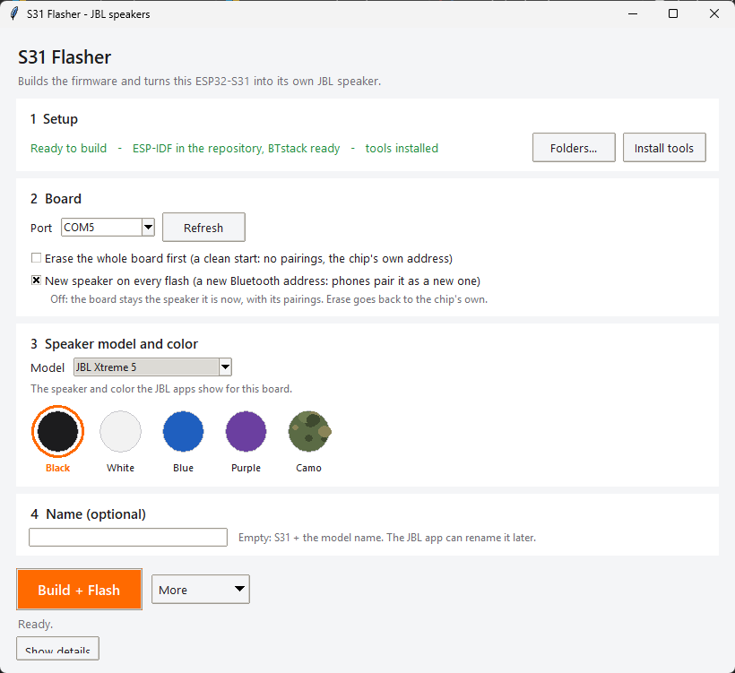
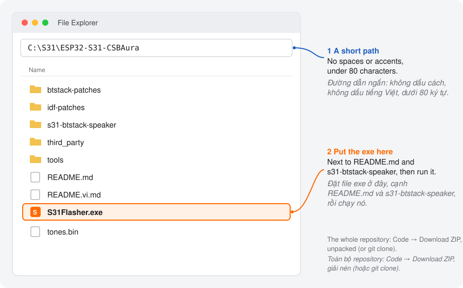

# S31 Flasher

**English** | [Tiếng Việt](README.vi.md)

`S31Flasher.exe` builds the firmware from this project folder and flashes an ESP32-S31 as a
JBL speaker (a JBL Xtreme 5 by default). Everything happens in one window: pick the board, the
model and the color, press **Build + Flash**.



Everything it builds from comes with the repository, already patched:
- **ESP-IDF** in [`third_party/esp-idf`](../../third_party/esp-idf/S31_README.md): Espressif's
  commit [`idf-patches/IDF_COMMIT`](../../idf-patches/IDF_COMMIT) with
  [`idf-patches/0010`](../../idf-patches/0010-controller-only-iso-rx.patch) and
  [`0011`](../../idf-patches/0011-btdm-task-stack-dma.patch) applied.
- **BTstack** in [`third_party/btstack`](../../third_party/btstack/S31_README.md).

Only ESP-IDF's tools (compiler, CMake, Ninja, a Python environment) can't live in the
repository. The first **Build + Flash** installs them by itself, from the internet or, with no
internet at all, from the offline package.

**Offline package.** The flasher looks for an `S31-offline` folder, or the
`S31-offline-tools-win64.zip` that unpacks to it, next to the exe or in the project folder.
The complete download (`S31-CSBAura-complete-win64.zip` on the Releases page) has it in
place. With it, the first Build + Flash:
- places ESP-IDF's tool archives where ESP-IDF's installer looks for them (it checks each
  one's SHA-256);
- installs the Python packages from its `wheels` folder (pip runs with no index);
- uses Python 3.12, installing Python 3.12.10 from the package if the PC has no 3.12.

The package holds exactly what this project is tested with. `tools/release/make_offline.py`
makes it.

## What you need

- Windows 10 or 11.
- The whole repository: **Code → Download ZIP** on GitHub, unpacked, or `git clone`.
- `S31Flasher.exe` from the [Releases](../../../../releases) page.
- An ESP32-S31 board with 16 MB flash and PSRAM, and a USB data cable.
- About 2 GB of free disk space for ESP-IDF's tools, and internet for the first build.

You don't need git, and you don't need to install Python yourself. If the PC has no Python
3.10 to 3.13, the first build installs Python 3.12 from python.org for this user only, into
`%LOCALAPPDATA%\S31Flasher\python` (not on PATH, no file associations).

## First time



1. Unpack the repository to a **short path**, for example `C:\S31\ESP32-S31-CSBAura`.
   It must be under 80 characters, without spaces or accented letters. ESP-IDF's deepest
   files are 175 characters deep inside it, and Windows paths stop at 260.
2. Put `S31Flasher.exe` into that folder, **next to `README.md` and `s31-btstack-speaker`**.
3. Run it. If Windows SmartScreen warns about an unknown app, choose **More info → Run anyway**.
4. **1 Setup** says **Ready to build**, and whether ESP-IDF's tools are installed yet.
5. Flash a board (below). The first **Build + Flash** installs ESP-IDF's ESP32-S31 tools with
   ESP-IDF's own installer, into `%USERPROFILE%\.espressif` (about 1 GB downloaded, several
   minutes, once), then builds. **Install tools** does only that part, if you want it done
   before plugging in a board.

Already have this exact ESP-IDF somewhere? Open **Folders...** and pick it. The flasher
checks the commit and the patches.

## Flash a board

1. Plug in the board. If it doesn't show up, hold **BOOT**, press **RESET**, then release
   **BOOT**.
2. **2 Board**: pick its port (press **Refresh** after plugging it in).
   - **New speaker on every flash** (on by default): see the next section.
   - **Erase the whole board first**: a clean start (no pairings, no settings, the chip's own
     address).
3. **3 Speaker model and color**: the model and a color. The list has the JBL models the
   firmware can be, with JBL's own color IDs for each.
4. **4 Name** (optional): the Bluetooth name. Empty means `S31` + the model name.
5. Press **Build + Flash**. The first build takes a few minutes; later ones about a minute.
   The progress bar and **Show details** show what it is doing.
6. The board restarts by itself as that speaker.

Close any serial monitor that has the board's port open before flashing: only one program
can use the port at a time.

**More** has:
- **Set model / color / name only**: rewrites only those. It keeps the firmware, the identity,
  the pairings and the settings, and takes a few seconds.
- **Flash the last build**: flashes what was built before, without building again.

The window remembers the port, the model and the **New speaker on every flash** setting.

## A new speaker on every flash, or the same one

A speaker's identity is its Bluetooth address. Its serial number, beacon address, `macCrc`
(how JBL One and JBL speakers tell speakers apart) and standard Auracast Broadcast_ID all
follow from it.

| Setting | The board after **Build + Flash** |
|---|---|
| **New speaker on every flash** on | A new speaker: a new Bluetooth address (`30:ED:A0` + 3 random bytes) and everything that follows from it. It clears the pairings of its old address and starts in pairing mode; phones and JBL One see a new speaker. |
| Off | The speaker it is now: the flasher reads the board's identity back and keeps it, with the pairings, the stereo pair and the settings. |
| **Erase the whole board first** | The chip's own factory address (unique per chip), nothing else kept. |

**Set model / color / name only** always keeps the identity.

The phone keeps its entry for a speaker whose address changed; forget that entry on the phone
if you don't need it any more.

The JBL party Broadcast_ID (`0x112233`) is the same on every board on purpose: real Xtreme 5
speakers only join a party with that ID.

## Xtreme 5 colors

JBL One reads the color from the speaker's BLE beacon. The IDs are JBL's own for the Xtreme 5
(its `model_config.json`, "official_color_name"):

| Color | ID |
|---|---|
| Black | `0x00` |
| White | `0x01` |
| Blue | `0x02` |
| Purple | `0x05` |
| Camo | `0x1A` |

## Prompt tones

The repository's `tones.bin` (the Xtreme 5 prompt set) is flashed with every Build + Flash,
so the board plays its power, pairing, connect and Auracast sounds right away. To use your
own sounds, replace `tones.bin` with one made by [`tools/tones_pack.py`](../tones_pack.py)
(see the main README).

## Troubleshooting

| Problem | Fix |
|---|---|
| No port in the list | Use a data cable (not charge-only), press **Refresh**, try BOOT + RESET. |
| `could not open port` / `Access is denied` | Another program (serial monitor, console) has the port open. Close it. |
| `Failed to connect to ESP32-S31` | Hold BOOT, press RESET, release BOOT, press **Build + Flash** again. |
| Installing the tools fails | Check the internet connection and press **Build + Flash** (or **Install tools**) again; it continues where it stopped. |
| `project folder's path is too long` | Move the repository to a shorter folder, for example `C:\S31\ESP32-S31-CSBAura`. |
| Build fails with a path error | Move the project to a short path without spaces, for example `C:\S31\...`. |
| Phone doesn't find or connect to the board | Press the pairing button (GPIO 42), then pick the speaker on the phone. After a new-speaker flash or an Erase, forget the old entry on the phone first. |
| JBL One shows the wrong color | Use **Set model / color / name only** with the right color, then close and reopen JBL One. |

The full log is under **Show details**. Copy it when asking for help.

## Command line

`S31Flasher.exe` with `--port` (or `python tools/flasher/s31_flasher.py`) does the same steps
without the window:

```
S31Flasher.exe --port COM5 --color blue [--name "Party Box"] [--new-identity] [--erase]
S31Flasher.exe --port COM5 --model "charge 5" --color teal --color-only
S31Flasher.exe --port COM5 --no-build
S31Flasher.exe --list-models
python tools/flasher/s31_flasher.py --setup
```

| Option | Does |
|---|---|
| `--port` | serial port, for example `COM5` |
| `--model` | the JBL model: PID (`2169`) or name (`"xtreme 5"`); default Xtreme 5 |
| `--list-models` | print the models and their colors |
| `--color` / `--color-id` | a color of the model (`black`, `white`, `blue`, `purple`, `camo` ...), or a raw ID like `0x1A` |
| `--name` | Bluetooth name |
| `--new-identity` | a new speaker (new Bluetooth address). Without it the command line keeps the board's identity, as with the toggle off |
| `--erase` | erase the whole flash first (pairings, settings, identity back to the chip's own) |
| `--color-only` | write only model + color + name (keeps the identity) |
| `--no-build` | flash the last build |
| `--setup` | only install ESP-IDF's tools (a build does it too when they are missing) |
| `--idf`, `--project` | use these folders instead of finding them |

Running the `.py` needs `esptool` and `pyserial`; ESP-IDF's Python environment has both.

## For maintainers

Build the exe (esptool is taken from the ESP-IDF Python environment):

```
pip install pyinstaller
python tools/flasher/build_exe.py      # -> tools/flasher/dist/S31Flasher.exe
```

`third_party/esp-idf` and `third_party/btstack` are made by `tools/release/promote.py` from
git checkouts at the pinned commits with the patches applied. It exports git's own bytes
(not a CRLF working tree), leaves out what nothing builds from, and checks that the result is
exactly upstream plus our patches.
