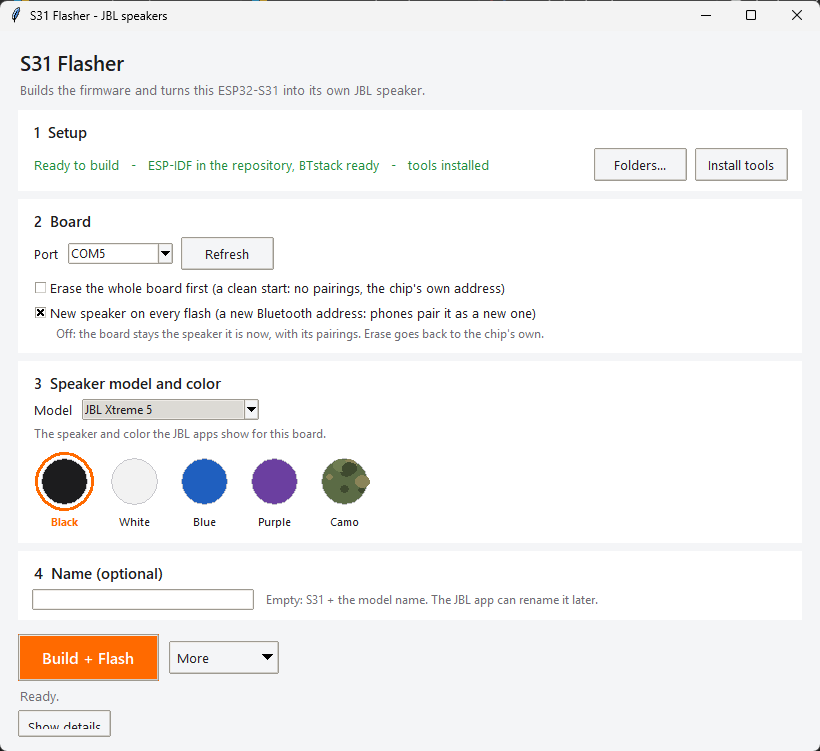
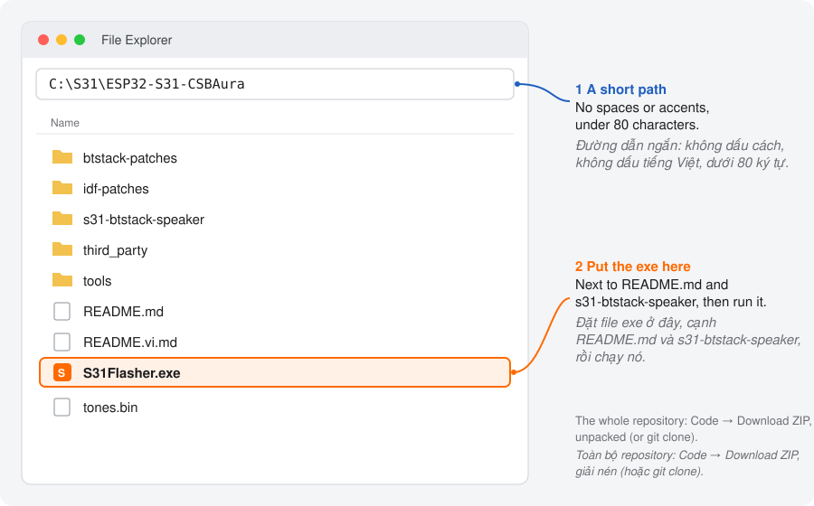

# S31 Flasher

[English](README.md) | **Tiếng Việt**

`S31Flasher.exe` build firmware từ thư mục dự án này và nạp vào ESP32-S31 để biến nó thành một
loa JBL (mặc định là JBL Xtreme 5). Mọi thứ diễn ra trong một cửa sổ: chọn bo mạch, mẫu loa và
màu, rồi bấm **Build + Flash**.



Mọi thứ cần để build đều có sẵn trong repository, đã vá:
- **ESP-IDF** trong [`third_party/esp-idf`](../../third_party/esp-idf/S31_README.md): commit
  [`idf-patches/IDF_COMMIT`](../../idf-patches/IDF_COMMIT) của Espressif, đã áp
  [`idf-patches/0010`](../../idf-patches/0010-controller-only-iso-rx.patch) và
  [`0011`](../../idf-patches/0011-btdm-task-stack-dma.patch).
- **BTstack** trong [`third_party/btstack`](../../third_party/btstack/S31_README.md).

Chỉ có công cụ của ESP-IDF (trình biên dịch, CMake, Ninja, môi trường Python) là không thể để
trong repository. Lần **Build + Flash** đầu tiên sẽ tự cài chúng, từ internet hoặc, khi không có
mạng, từ gói offline.

**Gói offline.** Trình nạp tìm thư mục `S31-offline`, hoặc file `S31-offline-tools-win64.zip`
giải nén ra thư mục đó, nằm cạnh file exe hoặc trong thư mục dự án. Bản tải đầy đủ
(`S31-CSBAura-complete-win64.zip` trên trang Releases) đã có sẵn thư mục này. Với gói này, lần
Build + Flash đầu tiên:
- đặt các file nén công cụ của ESP-IDF vào nơi trình cài của ESP-IDF tìm chúng (nó kiểm tra
  SHA-256 của từng file);
- cài các gói Python từ thư mục `wheels` (pip chạy không dùng index);
- dùng Python 3.12, và cài Python 3.12.10 từ gói nếu máy chưa có bản 3.12.

Gói này chứa đúng những gì dự án đã được kiểm thử. `tools/release/make_offline.py` tạo ra nó.

## Bạn cần gì

- Windows 10 hoặc 11.
- Toàn bộ repository: **Code → Download ZIP** trên GitHub rồi giải nén, hoặc `git clone`.
- `S31Flasher.exe` từ trang [Releases](../../../../releases).
- Một bo mạch ESP32-S31 có 16 MB flash và PSRAM, và một cáp USB có truyền dữ liệu.
- Khoảng 2 GB dung lượng trống cho công cụ của ESP-IDF, và có internet cho lần build đầu.

Không cần git, cũng không cần tự cài Python. Nếu máy chưa có Python 3.10 đến 3.13, lần build
đầu sẽ cài Python 3.12 từ python.org chỉ cho người dùng hiện tại, vào
`%LOCALAPPDATA%\S31Flasher\python` (không thêm vào PATH, không đổi liên kết file).

## Lần đầu tiên



1. Giải nén repository vào một **đường dẫn ngắn**, ví dụ `C:\S31\ESP32-S31-CSBAura`. Đường dẫn
   phải dưới 80 ký tự, không có dấu cách, không có chữ có dấu. Các file sâu nhất của ESP-IDF nằm
   sâu 175 ký tự bên trong, và đường dẫn trên Windows giới hạn ở 260 ký tự.
2. Đặt `S31Flasher.exe` vào thư mục đó, **cạnh `README.md` và `s31-btstack-speaker`**.
3. Chạy nó. Nếu Windows SmartScreen cảnh báo ứng dụng không rõ nguồn gốc, chọn
   **More info → Run anyway**.
4. **1 Setup** hiện **Ready to build**, và cho biết công cụ của ESP-IDF đã được cài chưa.
5. Nạp một bo mạch (xem bên dưới). Lần **Build + Flash** đầu tiên cài công cụ ESP32-S31 của
   ESP-IDF bằng trình cài đặt của chính ESP-IDF, vào `%USERPROFILE%\.espressif` (tải khoảng
   1 GB, mất vài phút, chỉ một lần), rồi build. **Install tools** chỉ làm phần cài đặt đó, nếu
   bạn muốn cài trước khi cắm bo mạch.

Đã có đúng bản ESP-IDF này ở chỗ khác? Mở **Folders...** và chọn nó. Trình nạp sẽ kiểm tra
commit và các bản vá.

## Nạp một bo mạch

1. Cắm bo mạch. Nếu nó không hiện ra, giữ **BOOT**, bấm **RESET**, rồi thả **BOOT**.
2. **2 Board**: chọn cổng của nó (bấm **Refresh** sau khi cắm).
   - **New speaker on every flash** (bật mặc định): xem phần tiếp theo.
   - **Erase the whole board first**: bắt đầu sạch (không còn ghép đôi, không còn cài đặt,
     dùng địa chỉ gốc của chip).
3. **3 Speaker model and color**: chọn mẫu loa và màu. Danh sách gồm các mẫu JBL mà firmware có
   thể giả lập, với mã màu riêng của JBL cho từng mẫu.
4. **4 Name** (không bắt buộc): tên Bluetooth. Để trống thì tên là `S31` + tên mẫu loa.
5. Bấm **Build + Flash**. Lần build đầu mất vài phút; các lần sau khoảng một phút. Thanh tiến
   trình và **Show details** cho biết nó đang làm gì.
6. Bo mạch tự khởi động lại thành chiếc loa đó.

Đóng mọi serial monitor đang mở cổng của bo mạch trước khi nạp: mỗi lúc chỉ một chương trình
dùng được cổng.

**More** có:
- **Set model / color / name only**: chỉ ghi lại mẫu, màu và tên. Giữ nguyên firmware, danh
  tính, các ghép đôi và cài đặt, chỉ mất vài giây.
- **Flash the last build**: nạp bản đã build trước đó, không build lại.

Cửa sổ nhớ cổng, mẫu loa và cài đặt **New speaker on every flash**.

## Mỗi lần nạp là một loa mới, hay giữ nguyên loa cũ

Danh tính của loa là địa chỉ Bluetooth. Số serial, địa chỉ beacon, `macCrc` (cách JBL One và
các loa JBL phân biệt từng loa) và Auracast Broadcast_ID chuẩn đều suy ra từ địa chỉ đó.

| Cài đặt | Bo mạch sau **Build + Flash** |
|---|---|
| **New speaker on every flash** bật | Một loa mới: địa chỉ Bluetooth mới (`30:ED:A0` + 3 byte ngẫu nhiên) và mọi thứ suy ra từ nó. Nó xóa các ghép đôi của địa chỉ cũ và tự vào chế độ ghép đôi; điện thoại và JBL One thấy một loa mới. |
| Tắt | Vẫn là chiếc loa hiện tại: trình nạp đọc lại danh tính trên bo mạch và giữ nguyên, cùng các ghép đôi, cặp stereo và cài đặt. |
| **Erase the whole board first** | Địa chỉ gốc của chip (mỗi chip một địa chỉ), không giữ lại gì khác. |

**Set model / color / name only** luôn giữ nguyên danh tính.

Điện thoại vẫn giữ mục của loa có địa chỉ đã đổi; hãy xóa (forget) mục đó trên điện thoại nếu
không cần nữa.

Broadcast_ID của bữa tiệc JBL (`0x112233`) cố ý giống nhau trên mọi bo mạch: loa Xtreme 5 thật
chỉ tham gia bữa tiệc có ID đó.

## Màu của Xtreme 5

JBL One đọc màu từ beacon BLE của loa. Đây là mã riêng của JBL cho Xtreme 5 (từ
`model_config.json` của nó, "official_color_name"):

| Màu | Mã |
|---|---|
| Black (Đen) | `0x00` |
| White (Trắng) | `0x01` |
| Blue (Xanh dương) | `0x02` |
| Purple (Tím) | `0x05` |
| Camo (Rằn ri) | `0x1A` |

## Âm báo

`tones.bin` trong repository (bộ âm báo của Xtreme 5) được nạp cùng mỗi lần Build + Flash, nên
bo mạch phát ngay các âm bật nguồn, ghép đôi, kết nối và Auracast. Muốn dùng âm của riêng bạn,
thay `tones.bin` bằng một file tạo bởi [`tools/tones_pack.py`](../tones_pack.py) (xem README
chính).

## Xử lý sự cố

| Vấn đề | Cách khắc phục |
|---|---|
| Danh sách không có cổng nào | Dùng cáp có truyền dữ liệu (không phải cáp chỉ sạc), bấm **Refresh**, thử BOOT + RESET. |
| `could not open port` / `Access is denied` | Một chương trình khác (serial monitor, console) đang mở cổng. Đóng nó lại. |
| `Failed to connect to ESP32-S31` | Giữ BOOT, bấm RESET, thả BOOT, rồi bấm **Build + Flash** lại. |
| Cài công cụ thất bại | Kiểm tra kết nối internet và bấm **Build + Flash** (hoặc **Install tools**) lại; nó tiếp tục từ chỗ đã dừng. |
| `project folder's path is too long` | Chuyển repository sang thư mục ngắn hơn, ví dụ `C:\S31\ESP32-S31-CSBAura`. |
| Build lỗi đường dẫn | Chuyển dự án sang đường dẫn ngắn không có dấu cách, ví dụ `C:\S31\...`. |
| Điện thoại không tìm thấy hoặc không kết nối được | Bấm nút ghép đôi (GPIO 42), rồi chọn loa trên điện thoại. Sau khi nạp loa mới hoặc Erase, hãy xóa mục cũ trên điện thoại trước. |
| JBL One hiện sai màu | Dùng **Set model / color / name only** với đúng màu, rồi đóng và mở lại JBL One. |

Toàn bộ log nằm trong **Show details**. Hãy sao chép nó khi cần hỏi trợ giúp.

## Dòng lệnh

`S31Flasher.exe` có `--port` (hoặc `python tools/flasher/s31_flasher.py`) làm đúng các bước đó
mà không cần cửa sổ:

```
S31Flasher.exe --port COM5 --color blue [--name "Party Box"] [--new-identity] [--erase]
S31Flasher.exe --port COM5 --model "charge 5" --color teal --color-only
S31Flasher.exe --port COM5 --no-build
S31Flasher.exe --list-models
python tools/flasher/s31_flasher.py --setup
```

| Tùy chọn | Tác dụng |
|---|---|
| `--port` | cổng serial, ví dụ `COM5` |
| `--model` | mẫu JBL: PID (`2169`) hoặc tên (`"xtreme 5"`); mặc định Xtreme 5 |
| `--list-models` | in danh sách mẫu loa và màu của chúng |
| `--color` / `--color-id` | một màu của mẫu đó (`black`, `white`, `blue`, `purple`, `camo` ...), hoặc mã thô như `0x1A` |
| `--name` | tên Bluetooth |
| `--new-identity` | một loa mới (địa chỉ Bluetooth mới). Không có tùy chọn này thì dòng lệnh giữ danh tính của bo mạch, như khi tắt nút gạt |
| `--erase` | xóa toàn bộ flash trước (ghép đôi, cài đặt; danh tính trở về địa chỉ gốc của chip) |
| `--color-only` | chỉ ghi mẫu + màu + tên (giữ nguyên danh tính) |
| `--no-build` | nạp bản build trước đó |
| `--setup` | chỉ cài công cụ của ESP-IDF (khi thiếu, việc build cũng tự cài) |
| `--idf`, `--project` | dùng các thư mục này thay vì tự tìm |

Chạy file `.py` cần `esptool` và `pyserial`; môi trường Python của ESP-IDF có sẵn cả hai.

## Dành cho người bảo trì

Build file exe (esptool được lấy từ môi trường Python của ESP-IDF):

```
pip install pyinstaller
python tools/flasher/build_exe.py      # -> tools/flasher/dist/S31Flasher.exe
```

`third_party/esp-idf` và `third_party/btstack` được tạo bởi `tools/release/promote.py` từ các
bản git checkout ở đúng commit đã ghim, có áp các bản vá. Nó xuất đúng các byte của git (không
phải cây làm việc CRLF), bỏ những gì không được build, và kiểm tra kết quả đúng bằng bản gốc
cộng các bản vá của chúng tôi.
